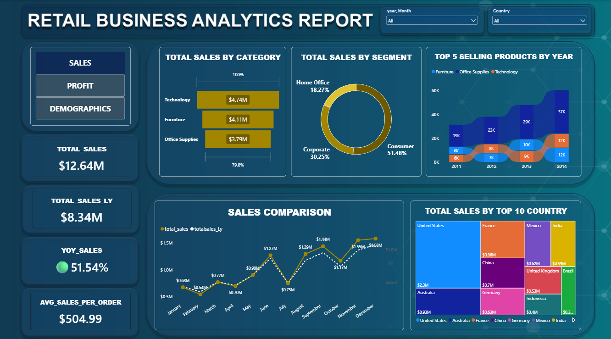
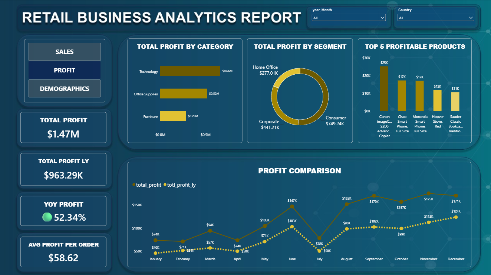
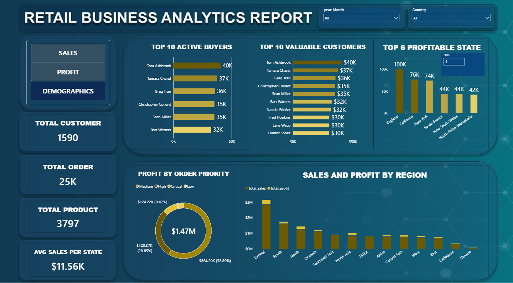

# Retail Business Analytics Report

## Project Overview
An interactive Power BI dashboard developed to analyze retail sales, profit, customer behavior, and overall business performance.

## Tools Used
- Power BI
- DAX (Data Analysis Expressions)
- Microsoft Excel

## Dashboard Pages

### Sales Dashboard

### Profit Dashboard

### Demographics Dashboard

## Key Analysis
- Sales performance by category and segment
- Profit analysis by category and segment
- Customer and regional analysis
- Sales and profit trends
- Key business performance indicators
